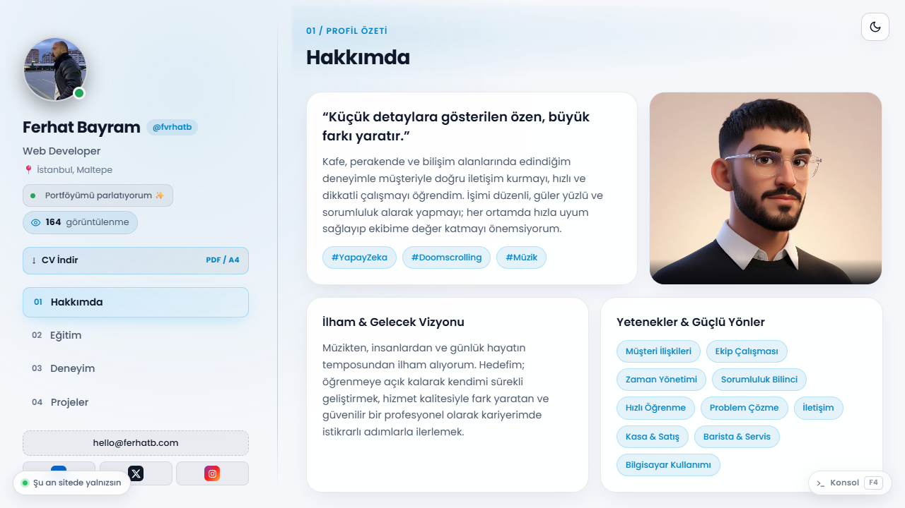
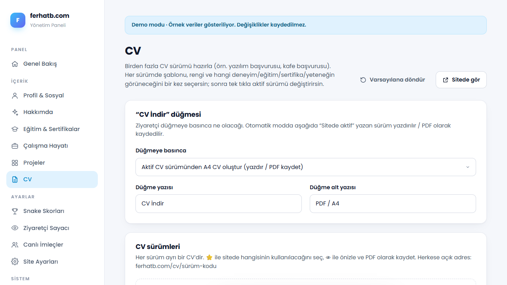
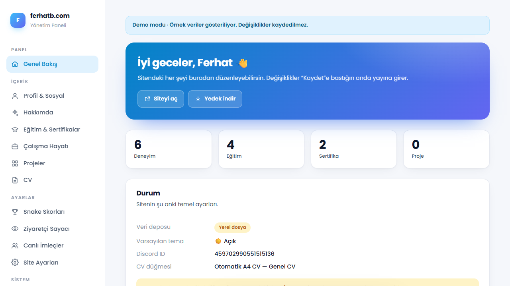

<div align="center">

# ferhatb.com

### Bir portföyden daha fazlası.

**Kişisel portföy, dinamik CV oluşturucu ve özel yönetim paneli — tek bir uygulamada.**

Projeleri keşfetmekten başvuruya özel bir CV hazırlamaya, içerikleri yönetmekten canlı durumu paylaşmaya kadar bütün deneyim tek bir yerde.

[**Siteyi ziyaret et ↗**](https://ferhatb.com) · [Proje detayları](https://ferhatb.com/projeler/ferhatb-portfolio) · [CV'yi görüntüle](https://ferhatb.com/cv)




</div>

## Fikir

Bir portföyün yalnızca statik bir özgeçmiş olmasını istemedim. Kendimi ve projelerimi anlatabileceğim, farklı başvurular için uygun CV'ler hazırlayabileceğim ve bütün içeriği kodu yeniden düzenlemeden yönetebileceğim bir alan tasarladım.

Sonuç; ziyaretçi tarafında kişisel bir vitrin, arka tarafta ise içerik, CV, projeler ve etkileşimleri yöneten özel bir panel olan **ferhatb.com**.

## Neler var?

### Portföy ve projeler

- Profil, eğitim, sertifikalar, deneyimler ve projeler panelden düzenlenir.
- Proje kartları; hikâye, yapılan işler, kullanılan araçlar ve görseller içeren detay sayfalarına açılır.
- Açık/koyu tema, mobil uyumlu arayüz ve klavyeden erişilebilen hızlı komut menüsü bulunur.
- Discord durumu ve etkinlikleri Lanyard ile gösterilir; Discord çevrimdışıysa veya Lanyard'a erişilemiyorsa, yapılandırılmış Spotify bağlantısı çalan parçayı gösterebilir.

### CV Studio

Bir CV, her başvuru için aynı olmak zorunda değil. Panelden birden fazla CV sürümü oluşturulabilir; her sürümde içerik ve görünüm ayrı düzenlenebilir.

- **Dört şablon:** Modern, Klasik, Zarif ve Kompakt.
- Sürüm başına başlık, özet, renk, dil ve bölüm görünürlüğü.
- Deneyim, eğitim, sertifika, proje ve yetenekler arasından sürüme özel seçim.
- Her sürüm için ayrı dil, ilgi alanı ve referans bilgileri.
- Tarayıcıda önizleme, yazdırma ve **PDF olarak kaydetme**; istenirse hazır PDF kullanımı.
- İsteğe bağlı **QR ve doğrulama kodu**: belgeyi alan kişi doğrulama sayfasından kodun tanınıp tanınmadığını ve CV içeriğinin güncelliğini kontrol edebilir.



### Yönetim paneli

Panel, içerik ve site ayarlarını tek bir yerden yönetmek için hazırlandı. Google ile giriş, yetkilendirilmiş hesap listesi ve kurucu hesabı kullanır. İçerik, görsel yükleme, CV sürümleri, ziyaret sayacı ve Snake skorları panelden yönetilebilir.

İsteğe bağlı **demo modu**, paneli örnek verilerle gösterir. Demo oturumunun yazma istekleri sunucu tarafında reddedilir; demo erişimi panel ayarlarından açılıp kapatılabilir.



### Küçük etkileşimler

Canlı ziyaretçi imleçleri, `W` ile selamlaşma, F4 komut menüsü, panelden ayarlanabilen emoji sürprizleri ve mini Snake oyunu sitenin kişisel tarafını oluşturur.

## Teknoloji

| Katman | Kullanım |
| --- | --- |
| **Node.js + Express** | Sunucu, API'ler, sunucu tarafında sayfa üretimi ve oturumlar |
| **HTML, CSS, JavaScript** | Portföy, CV ekranı ve yönetim paneli; ön yüz framework'ü yok |
| **Appwrite** | İçerik ve medya depolama; yapılandırılmadığında yerel dosya kullanımı |
| **Google OAuth 2.0** | Yetkili yöneticilerin Google hesabıyla girişi |
| **Lanyard + Spotify Web API** | Discord etkinliği ve Spotify fallback akışı |

## Mimariyi hızlıca anlamak

```text
Ziyaretçi
   ├── /                   → sunucuda oluşturulan portföy + tarayıcı JS/CSS
   ├── /projeler/:id       → proje detay sayfası
   ├── /cv/:id             → seçilen CV sürümü / yazdırma
   └── /cv/dogrula         → CV kodu doğrulama

Yönetici → Google OAuth → /admin → /api/admin/*
                                      │
                            Express / server/store.js
                                      │
                         Appwrite veya data/content.json

Canlı durum → Lanyard öncelikli → gerektiğinde /api/spotify/now-playing
                                  └── Spotify token ve cache: yalnızca sunucuda
```

`app.js` HTTP rotalarını birleştirir. İçerik bölümler hâlinde `server/store.js` üzerinden okunur ve kaydedilir; ana sayfa `server/render.js` ile üretilir. `public/js/cv-render.js`, tarayıcıdaki CV görünümü ve sunucudaki doğrulama özeti için ortak kuralları sağlar.

## Yerel kurulum

### Gereksinimler

- **Node.js 18.17 veya üzeri** ve npm
- Yönetici girişi için bir **Google OAuth Web application** istemcisi
- İsteğe bağlı olarak Appwrite projesi ve Spotify Developer uygulaması

### 1. Depoyu al ve bağımlılıkları kur

```bash
git clone https://github.com/fvrhatb/ferhatb-portfolio.git
cd ferhatb-portfolio
npm install
```

### 2. Ortam değişkenlerini hazırla

`.env.example` dosyasını `.env` adıyla kopyala. Aşağıdaki alanları kendi değerlerinle doldur:

```dotenv
NODE_ENV=development
PORT=3000
SESSION_SECRET=<en-az-32-karakterlik-rastgele-gizli-deger>

GOOGLE_CLIENT_ID=<google-oauth-client-id>
GOOGLE_CLIENT_SECRET=<google-oauth-client-secret>
GOOGLE_FOUNDER_EMAIL=<kurucu-google-hesabi>
GOOGLE_REDIRECT_URI=https://ferhatb.com/api/auth/google/callback
GOOGLE_REDIRECT_URI_LOCAL=http://localhost:3000/api/auth/google/callback
```

> Uygulama başlangıcında Google client ID, client secret ve en az 32 karakterlik `SESSION_SECRET` gereklidir. Farklı bir alan adı kullanıyorsan production callback adresini de ona göre değiştir.

Google Cloud Console'daki OAuth istemcisine redirect URI'leri **birebir** ekle:

```text
http://localhost:3000/api/auth/google/callback
https://ferhatb.com/api/auth/google/callback
```

Google uygulaması test modundaysa, giriş yapacak hesapların OAuth test kullanıcıları arasında da bulunması gerekebilir.

### 3. Veri deposunu seç

**Appwrite kullanacaksan** `.env` içindeki `APPWRITE_ENDPOINT`, `APPWRITE_PROJECT_ID`, `APPWRITE_API_KEY`, `APPWRITE_DATABASE_ID` ve `APPWRITE_COLLECTION_ID` değerlerini yapılandır. Storage için `APPWRITE_BUCKET_ID` kullanılır. İlk kurulum yardımcısı:

```bash
npm run setup:appwrite
```

**Yerel dosyayla çalışacaksan** `APPWRITE_PROJECT_ID` ve `APPWRITE_API_KEY` alanlarını boş bırak. Uygulama `data/content.json` dosyasını kullanır; dosya yoksa varsayılan içerikle başlar. Appwrite erişilemezse son yerel içerik kopyası kullanılabilir. Bu, tüm yazma işlemlerinin çevrimdışı çalışacağı anlamına gelmez.

### 4. Başlat

```bash
npm run dev
```

| Adres | Ne için? |
| --- | --- |
| `http://localhost:3000` | Portföy |
| `http://localhost:3000/admin` | Google girişli yönetim paneli |
| `http://localhost:3000/cv` | Aktif CV önizlemesi |
| `http://localhost:3000/cv/dogrula` | CV doğrulama |
| `http://localhost:3000/projeler/ferhatb-portfolio` | Bu projenin detay sayfası |

Production başlangıcı için `npm start` kullanılabilir. cPanel/Passenger kurulumunda uygulama kökü ve Node başlangıç dosyası `app.js` olarak yapılandırılmalıdır.

## Spotify bağlantısı

Spotify fallback isteğe bağlıdır. `SPOTIFY_CLIENT_ID`, `SPOTIFY_CLIENT_SECRET` ve `SPOTIFY_REDIRECT_URI` değerlerini doldur; callback adresini Spotify Developer Dashboard'a ekle. Yönetici olarak giriş yaptıktan sonra bir kez:

```text
https://ferhatb.com/api/spotify/login
```

adresini aç. Sunucu, refresh token'ı varsayılan olarak `data/spotify-tokens.json` içinde saklar ve access token'ı gerektiğinde yeniler. Spotify istekleri backend üzerinden yapılır; sonuç kısa süreli bellekte önbelleğe alınır. Redirect URI kullandığın ortamla ve Spotify Dashboard kaydıyla eşleşmelidir.

## Proje yapısı

```text
├── app.js                    # Express uygulaması ve HTTP rotaları
├── server/
│   ├── auth.js               # Yönetici/demo oturum kontrolü
│   ├── google-auth.js        # Google OAuth akışı
│   ├── admin-users.js        # Yetkili yönetici listesi
│   ├── store.js              # Appwrite / yerel içerik katmanı
│   ├── render.js             # Ana sayfa ve istemci verisi
│   ├── project-page.js       # Proje detay sayfaları
│   ├── verify.js             # CV kodu ve güncellik kontrolü
│   ├── spotify.js            # Spotify token yöneticisi ve cache
│   ├── snake.js              # Snake oyun ve skor akışı
│   └── views/index.html      # Ana sayfa şablonu
├── public/
│   ├── admin/                # Yönetim paneli
│   ├── js/                   # Portföy, CV ve canlı durum istemcisi
│   ├── css/                  # Site, CV ve proje detay stilleri
│   └── assets/               # Görseller ve imleçler
├── scripts/                  # Appwrite ve medya yardımcıları
├── test/                     # Node'un yerleşik testleri
└── .env.example              # Gizli değer içermeyen yapılandırma örneği
```

## Komutlar

```bash
npm run dev              # Dosya değişikliklerini izleyerek geliştir
npm start                # Sunucuyu başlat
npm run setup:appwrite   # Appwrite kurulum yardımcısı
npm run migrate:media    # Medya taşıma yardımcısı
node --test test/*.test.js
```

## Operasyon ve güvenlik notları

- `.env`, `data/`, `node_modules/`, yüklenen dosyalar ve deploy arşivleri Git dışında tutulur. **Client secret, API key ve token'ları repoya ekleme.**
- Spotify token dosyası ve yerel veriler sunucu dosya sistemine bağlıdır; sunucu taşınmadan veya temizlenmeden önce gerekli dosyaları yedekle.
- Demo hesabı Google yöneticisi değildir; panelde değişiklik yapamaz. Demo sayfaları gerçek özel yönetici verileri yerine örnek veri gösterir.
- Snake oyun oturumları süreç belleğinde tutulur. Sunucu yeniden başlarsa devam eden oyunlar sona erer; çoklu sunucu için ortak oturum yönetimi gerekir.
- CV ve proje içeriklerini yayımlamadan önce gizli kalmasını istediğin bilgilerin herkese açık sayfalara gönderilmediğini ayrıca kontrol et.

## İletişim

**Ferhat Bayram** · [ferhatb.com](https://ferhatb.com) · [LinkedIn](https://www.linkedin.com/in/fvrhatb/) · [GitHub](https://github.com/fvrhatb)

<div align="center"><sub>Fikirden yayına, detayları önemseyerek geliştirildi.</sub></div>
